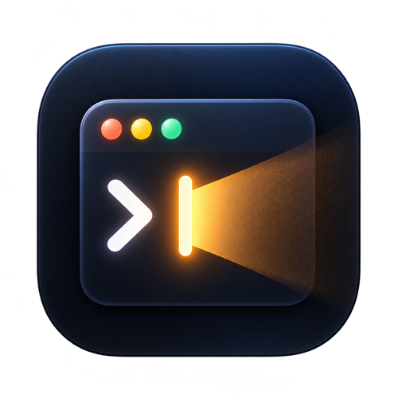

<div align="center">
  

  # Vibe Coding Light

  A system tray status light for AI coding agents, with a desktop pet companion.

  [中文文档](./README_CN.md) · [Download the stable release](https://github.com/TJU-ICLearner/vibe-coding-light/releases/latest)

  
</div>

It shows a colored indicator in your system tray so you can tell at a glance what your AI agent is doing — without keeping the terminal visible. Bubu, the built-in animated desktop pet, reacts to your agent's status.

Stable 1.0.0 supports **[Claude Code](https://docs.anthropic.com/en/docs/claude-code)** and **[OpenAI Codex CLI](https://github.com/openai/codex)**. This development branch also adds optional hooks for Cursor, TRAE, Grok Build, and DeepSeek Harness; the latter needs its official bridge mounted separately.

**Current stable release: 1.0.0.** Earlier GitHub releases were development test builds. Because the stable release restarts version numbering, install 1.0.0 manually from the [latest release](https://github.com/TJU-ICLearner/vibe-coding-light/releases/latest); older builds may not detect the smaller version number as an update.

## Contents

- [Download and install](#install)
- [First-time setup](#first-time-setup)
- [Status indicators](#status-indicators)
- [Desktop pet and custom images](#desktop-pet)
- [Bark phone and watch notifications](#optional-watch-notifications)
- [Troubleshooting](#troubleshooting)
- [Data and privacy](#how-it-works)
- [Build from source](#build-from-source)

## Install

### Download the stable release

Download the installer for your system from the [latest release](https://github.com/TJU-ICLearner/vibe-coding-light/releases/latest):

| System | Package | Install |
|---|---|---|
| macOS 12+ (Apple Silicon) | [DMG](https://github.com/TJU-ICLearner/vibe-coding-light/releases/download/v1.0.0/Vibe.Coding.Light_1.0.0_aarch64.dmg) | Open the DMG, drag **Vibe Coding Light.app** into Applications, then launch it from Applications. |
| Windows 10+ (x64) | [Installer](https://github.com/TJU-ICLearner/vibe-coding-light/releases/download/v1.0.0/Vibe.Coding.Light_1.0.0_x64-setup.exe) | Run `-setup.exe`, follow the installer, then launch from Start. |
| Linux (amd64) | [AppImage](https://github.com/TJU-ICLearner/vibe-coding-light/releases/download/v1.0.0/Vibe.Coding.Light_1.0.0_amd64.AppImage) | Make it executable and run; a graphical desktop and WebKitGTK 4.1 are required. |

On Linux, from the download directory:

```bash
chmod +x Vibe.Coding.Light_1.0.0_amd64.AppImage
./Vibe.Coding.Light_1.0.0_amd64.AppImage
```

The release also includes [SHA256SUMS.txt](https://github.com/TJU-ICLearner/vibe-coding-light/releases/download/v1.0.0/SHA256SUMS.txt). Compute the installer's digest with `shasum -a 256 <filename>` on macOS, `sha256sum <filename>` on Linux, or `Get-FileHash <filename> -Algorithm SHA256` in Windows PowerShell, then compare it with the corresponding entry in the file.
Replace `<filename>` with the downloaded file's actual name. In PowerShell, quote paths that contain spaces.

The macOS build is ad-hoc signed but has no Apple Developer ID signature or notarization; first launch may require **Open Anyway** in System Settings → Privacy & Security. The Windows installer is unsigned. Intel Mac users can build from source. Linux requires a desktop environment and WebKitGTK 4.1.

> **Screenshot placeholder | Installation:** Show the macOS app, the Windows tray icon after installation, and the pet running from the Linux AppImage. Add the images to `docs/images/` and replace this paragraph.

The app keeps the existing `com.cuihuapeng.code-light` bundle identifier and `~/.code-light` hook data directory so previous local settings remain available after the rename.

### Prerequisites

- macOS 12+ / a Linux graphical desktop / Windows 10+
- [Claude Code CLI](https://docs.anthropic.com/en/docs/claude-code) and/or [Codex CLI](https://github.com/openai/codex) installed
- Node.js 18+, [pnpm](https://pnpm.io/), and the [Rust](https://rustup.rs/) toolchain for source builds
- Windows users need [Git for Windows](https://git-scm.com/) with Git Bash and Perl (JSON::PP and Time::HiRes) for Claude/Codex hooks. Linux hooks need Bash and Perl (JSON::PP and Time::HiRes); Linux Bark keys require a running Secret Service provider (such as GNOME Keyring or KWallet).

### Build from source

```bash
git clone https://github.com/TJU-ICLearner/vibe-coding-light.git
cd vibe-coding-light
pnpm install
pnpm tauri build
```

Built artifacts:

| Platform | Location |
|----------|----------|
| macOS | `src-tauri/target/release/bundle/macos/Vibe Coding Light.app` |
| Linux | `src-tauri/target/release/bundle/appimage/*.AppImage` |
| Windows | `src-tauri/target/release/bundle/nsis/Vibe Coding Light_*.exe` |

## First-time setup

1. **Launch the app.** A gray dot appears in the menu bar/system tray and Bubu appears on your desktop. On macOS the app runs as a menu bar accessory without a Dock icon.
2. **Open its controls.** On macOS, left-click the dot for a panel that stays open while you change switches; click outside or press `Esc` to close it. Right-click the macOS icon, or click the Windows/Linux tray icon, for the native menu.
3. **Choose your language.** The menu, status text, and settings pages switch together. Chinese is selected on a Chinese-language system at first launch; other system languages default to English.
4. **Install hooks.** Choose **Setup Claude Hooks** if you use Claude Code and **Setup Codex Hooks** if you use Codex CLI. Install both if you use both agents. The menu shows whether installation succeeded. On Windows, prepare Git Bash and Perl from Git for Windows; Linux needs Bash and Perl.
5. **Start a fresh agent session.** Run the agent in a terminal and let it make a tool call. The indicator should turn green and Bubu should switch to the working animation. Existing agent sessions may need to restart before they load new hooks.
6. **One extra Codex step:** In Codex CLI, enter `/hooks` and press `t` to trust all hooks. Installed hooks may not run until you do this.

You can stop here if you do not need Bark. For phone/watch alerts, continue with [Notification Settings](#optional-watch-notifications).

> **Screenshot placeholder | First-time setup:** Show the language and Claude/Codex hook entries in the menu bar/tray controls and the installed-success message. Hide private project names. Add media to `docs/images/` and replace this paragraph.

The tray controls also offer **Launch at login** and **Automatically check for updates** switches, plus **Check for updates** at any time. Automatic checks run at most once per day and fall back to GitHub's release feed if the API is unavailable. If a new version is found, selecting its menu entry opens the GitHub release page; the app does not install updates automatically. On macOS, move the app to Applications before enabling launch at login. macOS 13+ prefers a system login item; a user LaunchAgent is available as a fallback.

## Status Indicators

| Color | State | Description |
|:---:|---|---|
| Gray | Idle | No active sessions |
| Gray | Unknown | No agent event for 5 minutes; the session may still be running |
| Green (blinking) | Working | Agent is executing tool calls |
| Yellow (blinking) | Waiting | Claude Code or Codex requested approval or interactive input |
| Red (blinking) | Error | An error has occurred |
| Blue | Completed | Current reply ended (displays for about 10 seconds, then returns to idle) |

Active states blink every 500ms to catch your attention. The tray tooltip shows the current state, active session count, and last update time.

**Sessions** lists up to eight recent sessions with source, project, state, and last activity. It omits raw task, command, and error text, and excludes sessions inactive for more than five minutes.

**When does Waiting appear?** Claude Code permission or interactive notifications and Codex `PermissionRequest` hooks trigger it. Ordinary work without an approval prompt can go directly from Working to Completed, then return to Idle. It does not mean that the app detects every moment an agent is waiting for a free-form user reply.

With multiple sessions, the icon shows the highest-priority state: **Error → Waiting → Working → Completed → Unknown → Idle**. Unknown does not mean the task ended; no new hook event may have arrived. Completed means the current reply ended, not that the entire project is finished. Later events can reactivate the same session.

> **Screenshot placeholder | Tray states:** Show the five indicator colors and the expanded recent-sessions menu, ideally in one collage. Add the image to `docs/images/` and replace this paragraph.

## Desktop Pet

Vibe Coding Light includes Bubu as its built-in desktop pet. New installations show Bubu by default; an existing custom-pet selection stays selected after updating. The five original transparent GIFs play without extra motion effects.

| State | Animation |
|:---:|---|
| Idle | Sleeping |
| Working | Working at a keyboard |
| Waiting | Drinking bubble tea |
| Error | Apologizing |
| Completed | Dancing |

> **Demo placeholder | Bubu's five states:** Show the original GIF for each state in a collage or short video. Add the media to `docs/images/` and replace this paragraph.

**Toggle the pet:** Select **Show Pet** or **Hide Pet** in the tray controls. On macOS, left-click the menu bar icon to open a panel that stays open while you change switches; click outside it or press `Esc` to close it. Right-click the macOS icon for the native menu. On Windows/Linux, click the tray icon for its native menu.

**Interface language:** Open the tray menu and choose **Language → English** or **Language → Chinese**. Menu items, status tooltip, settings title, and pet settings change immediately. Your choice is saved across launches; the first launch follows your system's preferred language (Chinese for a Chinese system language, English otherwise).

The pet window is always on top and draggable, so you can position it anywhere on your screen. On macOS 13 and later, it also attempts to stay visible in other apps' native full-screen spaces.
Choose **Pet the Pet** in the tray menu, or press **⌘B** on macOS (**Ctrl+B** on Windows/Linux), to see a hand gently pat the active pet twice. The action works with Bubu and custom pets. Some Bubu GIFs contain Chinese text as part of their original artwork, including when the interface language is English.

### Create a custom pet

1. Open the tray menu and choose **Customize Pet**.
   With the pet window focused, **⌘,** on macOS or **Ctrl+,** on Windows/Linux also opens this window.
2. Choose **One image for every state** to use one asset, or **Different images for each state** to edit five clearly separated tabs: required Default / Rest plus optional Working, Waiting, Error, and Completed. The preview stays next to the editor on wide windows and above it on narrow windows. Missing state assets use the default. Switching modes keeps your draft; saving in single-image mode stores only the default.
3. Each slot accepts PNG, JPEG, or a transparent GIF (up to 10 MiB per file and 25 MiB for the whole pet). On macOS 14+, choose **Remove background automatically** for a still image; choose **Keep transparent PNG** for an image with existing transparency. Transparent PNG and GIF work on all supported desktop systems. GIFs require **Keep transparent GIF animation** and are not cut out frame by frame. Still images may be up to 4096 pixels per side; GIFs may be up to 1024 pixels per side and must have 2–120 frames.
4. For each static image, choose its own motion: follow the agent state, still, sway, float, breathe, bounce, or wobble. GIFs keep their own animation and do not offer an extra motion effect. An empty state uses the default image and its motion.
5. Preview each state, enter a **1–64 character** name and a size from **0.5 to 3**, then click **Save and Use**. The pet window grows with the image, and the preview shows its actual window dimensions. Previewing alone does not replace the active pet. **My pets** lets you select or delete saved pets and return to **Default Bubu**; built-in Bubu cannot be deleted.

Static assets are stored as processed 256×256 PNGs; GIF bytes, timing, and loop settings are kept. Everything stays in Vibe Coding Light's local app data; source photos are not uploaded. Existing single-image pets remain usable, including their saved placement. New pets are centered; horizontal and vertical offset controls have been removed. Windows and Linux also support transparent PNG/GIF custom pets.

> **Screenshot placeholder | Custom pet editor:** Show the one-image/state tabs, asset preview, per-image motion, and size slider. Include a transparent GIF preview if possible. Add the image to `docs/images/` and replace this paragraph.

**Choosing an image:** A clear, centered subject is easier to fit into the pet preview. A GIF must already have a transparent background; if yours is opaque, prepare it in another tool before importing. Source images are not uploaded.

## Optional watch notifications

**Bark notifications are optional and off by default.** Install Bark on your iPhone and allow notifications, then configure Apple Watch to receive Bark notifications. Pushes reach iPhone first; Apple's notification rules decide whether they appear on the watch. The app currently uses Bark's official `api.day.app` server.

### Enable notifications

1. Open **Notification Settings → Connect Bark**. Copy only the **device key** from Bark's sample URL. For `https://api.day.app/<device-key>/title/body?group=example`, enter just `<device-key>`, without `/title/body` or query parameters. Click **Save key** and confirm **Saved in the system credential store**. Do not share the key or include it in screenshots.
2. Turn on the **Watch notifications** master switch. Under **Sources**, select Claude Code and/or Codex. If a source says **Hook not installed**, install it from the tray menu and restart that agent session.
3. Select the **Work events** and **Quota alerts** you want. Switch changes save automatically. Turning off a source stops all its alerts; turning off the master switch or quitting the app stops pushes. Previously installed app hooks are updated on upgrade.
4. Configure wording, details, and quiet hours as needed. The stable release has no connection-test or simulated-event buttons. Use **Notification diagnostics** to see whether a real event was observed, sent, skipped, or failed.

### Connect other coding assistants

In **Notification Settings → Sources**, Cursor, TRAE, Grok Build, and DeepSeek Harness have separate switches; new sources start off. Click **Install Hook** beside a source, or install it from **Quick Controls → Other Agent Hooks** in the macOS menu bar. Then enable that source and the work events you want, and restart its client. Installation preserves existing hooks. These sources use the existing pet state, Bark, and quiet-hour rules. Quota alerts are currently available only for Claude Code and Codex.

| Source | Configuration | Observable events |
| --- | --- | --- |
| Cursor | `~/.cursor/hooks.json` | Working, tool failure, reply completed; some approvals and questions have no separate hook |
| TRAE China | `~/.trae-cn/hooks.json` | Working, completed, approval, question notifications, tool failure |
| Grok Build CLI | `~/.grok/hooks/vibe-coding-light.json` | Working, completed, permission denied, errors and notifications |
| DeepSeek Harness | `~/.code-light/hooks/deepseek/` | Working, completed and tool failure through the official Codex Hook bridge |

**DeepSeek Harness also requires its bridge to be mounted.** Install Hook generates `hooks.json` and `cordis.patch.yml` but does not alter Harness global configuration or install packages. Install the official `@deepseek-ai/dsh-hooks-codex` package into the Harness profile you use, then add the rows from `~/.code-light/hooks/deepseek/cordis.patch.yml` to that profile's patch, or start with `dsh --patch ~/.code-light/hooks/deepseek/cordis.patch.yml`. Confirm `vibe-coding-light-hooks` appears in `dsh --dump-config`, then restart the Harness session. Profile and plugin management in the preview desktop app can change; consult its current documentation.

The ordinary Doubao app and **Grok Bot** currently expose no local lifecycle hooks for these work events. TRAE and Grok Build are separate products. Cursor, TRAE, and Grok Build may also read other clients' compatibility hooks; the app skips known duplicate invocations. If a client blocks custom hooks, no corresponding event appears in notification diagnostics.

### Events and quota thresholds

| Switch | Meaning |
|---|---|
| Permission approval needed | An observable agent permission request. |
| Answer needed | An interactive question captured by a Hook; some questions inside Codex have no observable Hook. |
| Current turn completed | The current reply ended, not the whole project; resumed work can cancel a pending completion alert. |
| Execution error | A Hook recorded a tool or command failure. |
| 80%, 50%, 20% remaining | Available quota crosses the corresponding remaining threshold. |
| 0% remaining, other periods | A quota period other than seven days is exhausted. |
| 7-day quota exhausted | A separate switch for the seven-day period reaching 0%. |
| Quota recovered | Quota becomes available again after exhaustion was observed. |

Quota alerts are separate for each **agent and period**, and the notification identifies the period. The first reading establishes a baseline; thresholds crossed before that reading are not backfilled. Therefore enabling a threshold does not necessarily send an immediate alert. Claude or Codex quota data can be unavailable with some client versions or sign-in methods; the settings page shows **Quota available/unavailable** for each agent.

### Customize titles and bodies

Under **Notification wording**, select an event and edit its title and body. Leave a field blank for its default; **Restore this event's defaults** clears that event's custom wording. Chinese and English wording are saved separately, so switch interface language to edit each. The example preview uses sample text, never a real task. Titles allow up to 120 characters and bodies up to 2,000.

| Variable | Inserts |
|---|---|
| `{source}` | Claude Code or Codex. |
| `{detail}` | Brief detail relevant to the event. |
| `{task}`, `{command}` | Original task or command when available. |
| `{error}`, `{reply}`, `{question}` | Original error, reply, or question when available. |
| `{period}`, `{remaining}` | Quota period and remaining percentage. |

**Include details is off by default.** While off, raw task, command, error, and reply text is not recorded in notification event files or sent to Bark; the corresponding variables are empty. When on, relevant original text may be sent, limited to the first 1,000 characters of each field. It can contain private information or secrets. Both 0% switches share one wording template; use `{period}` to distinguish them.

### Quiet hours and diagnostics

Quiet hours are off by default; the initial interval is **22:00–08:00** in the computer's local time. Permission, question, and error alerts still send by default during that interval. Adjust each item under **Still send these alerts**, including quota alerts. Muted events are not sent later.

**Notification diagnostics** keeps the latest 100 results locally, with source, event type, time, and outcome. It does not store notification bodies, raw task/command/error text, or the Bark key, and can be cleared. If a notification is missing, check reasons such as **Source is off**, **Event type is off**, **Quiet hours**, **No Bark key saved**, or **Network unavailable**. **Submitted to Bark** means Bark accepted the request; Apple's settings still control whether it appears on the watch.

> **Screenshot placeholder | Bark settings:** Show the master switch, saved-key status, source/event/quota switches, quiet hours, and diagnostics. A second screenshot can show wording and example preview. Hide the Bark key and private task details. Add media to `docs/images/` and replace this paragraph.

## Troubleshooting

### The indicator stays gray after installing hooks

Check that you installed the hook for the agent you are using, **start a fresh agent session**, and let it make a tool call. In Codex CLI, run `/hooks` and press `t` to trust. Check Git Bash and Perl on Windows or Bash and Perl on Linux; the menu reports missing dependencies. If nothing changes, see whether a new JSON status file appears in `~/.code-light/sessions/`.

### Why does Waiting rarely appear?

Waiting is triggered only by approval or interactive requests that a Hook can observe. Work without approval normally goes straight to Completed. Some questions inside Codex have no observable Hook, so they may not trigger a waiting state or a question alert.

### Bark did not reach my phone or watch

Check **Notification diagnostics** first for the skip or failure reason, then verify the master, source, and event switches, hook status, and device key. The key is only the first path segment after the test URL's domain, without `/title/body`. If diagnostics says **Submitted to Bark** but the watch shows nothing, review Bark on iPhone and Apple Watch notification settings. Quota alerts also require **Quota available** and a new threshold crossing; the first reading does not backfill earlier thresholds.

### What differs between Windows/Linux and macOS?

All three platforms support the status light, Claude/Codex hooks, Bubu and custom transparent PNG/GIF pets, Bark, language switching, and update checks. **Automatic background removal for still images currently requires macOS 14+.** Windows hooks need Git Bash and Perl from Git for Windows. Linux hooks need Bash and Perl; Bark key storage also needs a running Secret Service provider such as GNOME Keyring or KWallet. The Linux AppImage requires a graphical desktop with WebKitGTK 4.1.

### macOS: "App is damaged" or "cannot be opened" error

Download the DMG again and compare its digest with `SHA256SUMS.txt` on the release page. After confirming its integrity and source, drag the app into Applications and try **Open Anyway** in System Settings → Privacy & Security. If macOS still reports it as damaged, remove quarantine only from this app:

```bash
xattr -cr "/Applications/Vibe Coding Light.app"
```

Then reopen the app. Do not run this command on files whose source or checksum you cannot verify.

### Multi-session support

When Claude Code and/or Codex run in different terminals, the app tracks all active sessions and uses the highest-priority state for the tray icon. **Sessions** shows up to eight recent sessions so you can see which project is active.

### Automatic cleanup

- Sessions with no activity for 5 minutes show "Status unknown"; their files are removed after 24 hours
- Only a `Stop` hook reports completion, and a later event can reactivate the same session
- Completed sessions are cleaned up after the 10-second display window

## How It Works

Vibe Coding Light uses a file-based polling mechanism:

1. **Shell hooks** are registered as lifecycle hooks for Claude Code (`~/.claude/settings.json`) and Codex (`~/.codex/hooks.json`)
2. Each hook writes a JSON state file to `~/.code-light/sessions/<session-id>.json`
3. The tray app polls these files every second and updates the icon

```
Agent event → Hook script → ~/.code-light/sessions/*.json → Tray icon
```

The status light opens no network port. Only when you enable Bark notifications does the app send brief selected-event pushes to Bark. Manual or enabled daily update checks access this project's GitHub Releases API.

Custom pet assets and preferences stay in the local app data directory. The Bark device key is kept in the system credential store. Notification diagnostics keeps only the latest 100 metadata entries locally. The **Include details** switch controls whether original task, command, error, and reply text may be sent to Bark; it is off by default.

## Development

```bash
# Install dependencies
pnpm install

# Run in development mode
pnpm tauri dev

# Build for production
pnpm tauri build

# Lint Rust code
cd src-tauri && cargo clippy
```

## Project Structure

```
vibe-coding-light/
├── hooks/
│   ├── claude/                      # Claude Code hook scripts
│   │   ├── _helpers.sh              # Shared helpers (session ID from env, atomic write)
│   │   ├── pre-tool-use.sh          # → working
│   │   ├── post-tool-use.sh         # Tool-call completion event
│   │   ├── post-tool-use-failure.sh # → error
│   │   ├── notification.sh          # → waiting (on permission prompts)
│   │   ├── user-prompt-submit.sh    # User-submitted prompt
│   │   └── stop.sh                  # → completed
│   └── codex/                       # Codex CLI hook scripts
│       ├── _helpers.sh              # Shared helpers (session ID from stdin JSON)
│       ├── session_start.sh         # → working
│       ├── pre_tool_use.sh          # → working
│       ├── permission_request.sh    # → waiting
│       ├── post_tool_use.sh         # → working
│       ├── user_prompt_submit.sh    # → working
│       └── stop.sh                  # → completed
├── public/pet/
│   └── bubu/                        # Five built-in Bubu state GIFs
├── src-tauri/                       # Tauri v2 / Rust backend
│   ├── src/
│   │   ├── main.rs                  # Entry point
│   │   ├── lib.rs                   # Tray, polling, Hook setup, and windows
│   │   └── notifications/           # Bark, quotas, quiet hours, and diagnostics
│   ├── icons/status/                # Status indicator PNGs (gray, green, yellow, red, blue)
│   └── tauri.conf.json              # Tauri configuration
├── src/                             # Tray panel, pet, and settings frontend
├── generate-sprites.cjs             # Sprite sheet generator for desktop pet
├── package.json
└── vite.config.ts
```

## Supported Agents & Events

| Event | Claude Code | Codex CLI |
|-------|:-----------:|:---------:|
| Session Start | - | working |
| Pre Tool Use | working | working |
| Permission / Notification | waiting | waiting |
| Post Tool Use | - | working |
| Tool Use Failure | error | - |
| User Prompt Submit | - | working |
| Stop | completed | completed |

## Tech Stack

- **Backend:** [Tauri v2](https://v2.tauri.app/) + Rust
- **Frontend:** Vite + TypeScript for the pet and settings windows
- **Hooks:** Bash scripts registered as lifecycle hooks
- **Desktop Pet:** Built-in transparent Bubu GIFs and local preview/rendering for custom still images and transparent PNG/GIF

## License

MIT
